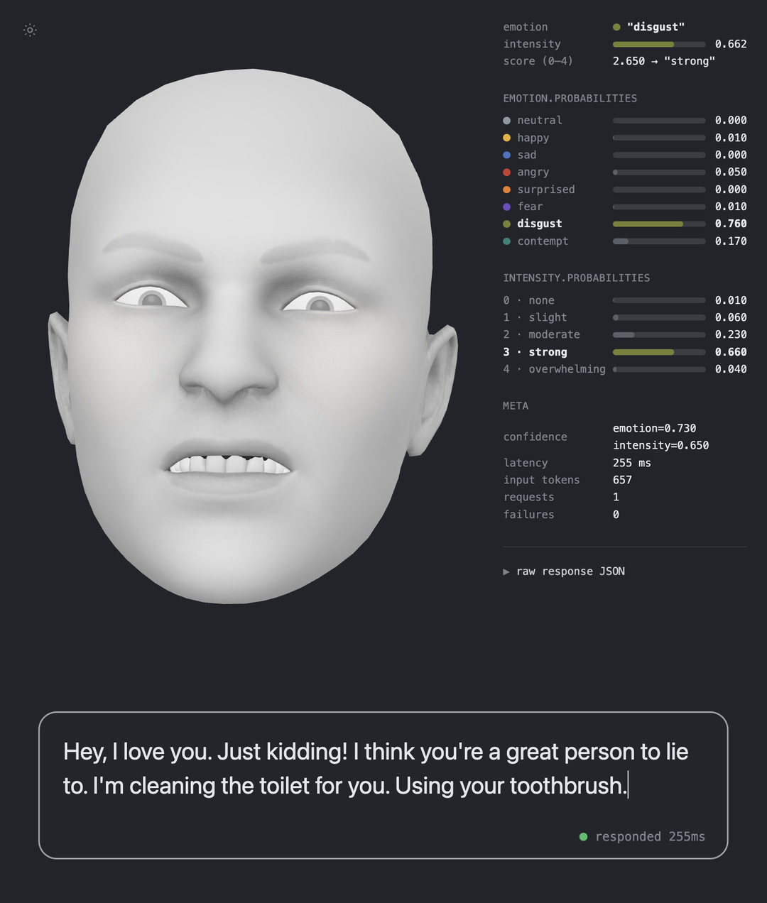

# jev-face

A 3D face that reacts in real time to what you type. While you type, TypeSafe AI's **Jev** judges which emotion the recipient would feel and how strongly, and the answer drives 52 ARKit blendshapes on a face mesh.



## The idea

Jev is a decision model. You give it state and typed questions, and it answers with a `choice`, a `score`, or a probability instead of prose. Two questions run in parallel here:

| Question | Type | Answer |
| --- | --- | --- |
| `emotion` | `choice` | 1 of 8 emotions, plus a probability for each |
| `intensity` | `score` | 0–4 on a rubric, plus a probability per level |

Both come back in under 400ms for well under a thousandth of a cent, which is what makes it viable to re-ask on every keystroke.

## The part that actually matters

**Do not use only the winning emotion.** Jev returns a full distribution, and if you snap the face to the top answer the expression jumps on every keystroke. Weighting all eight poses by their probabilities and lerping toward the result each frame is what makes it read as a face rather than a slideshow:

```js
target.fill(0);
const strength = 0.35 + 0.65 * (score / 4);

probabilities.forEach((p, i) => {
  if (p < 0.01) return;
  const vector = poseVectors[EMOTION_ORDER[i]];
  for (let k = 0; k < target.length; k++) target[k] += vector[k] * p * strength;
});
```

`intensity` scales the whole blend, so a mild insult barely moves the face and an overwhelming one commits to it.

## Setup

```bash
pnpm install
cp .env.example .env     # add one key
pnpm dev                 # http://localhost:5180
pnpm test                # verifies every pose references a real blendshape
```

Jev is reachable two ways. The request bodies are identical, so [api/evaluate.js](api/evaluate.js) picks based on which key is present:

| Key in `.env` | Endpoint | Model id |
| --- | --- | --- |
| `TYPESAFE_API_KEY` | `api.typesafe.ai/v1/systemone` | `jev-latest` |
| `AI_GATEWAY_API_KEY` | `ai-gateway.vercel.sh/typesafe/v1/systemone` | `typesafe-ai/jev` |

TypeSafe keys start with `apikey_`, Vercel AI Gateway keys with `vck_`. Jev is not a free-tier model on AI Gateway, so that route needs purchased credits.

The key never reaches the browser. The client posts `{ text }` and the question schema is built server-side, so a deployed instance can't be used as an open proxy. `pnpm dev` reads `.env` once at startup — restart after changing a key.

## Layout

The UI is a reconstruction (see [Credits](#credits)), measured off video frames rather than guessed:

| | Target |
| --- | --- |
| Head width | 53.7% of frame |
| Crown | 7.7% from top |
| Head center | 32.8% across |
| Panel | 65.6% to 97.4% |

Everything inside `#frame` is sized in `cqw`, so the composition holds at any window size and the leftover space letterboxes. The camera is not hard-coded: `frameHead()` solves for distance from the model's bounding box, so the framing survives a resize.

## Files

| File | What it does |
| --- | --- |
| [src/main.js](src/main.js) | three.js scene, camera framing, pose blending, typing → request |
| [src/emotions.js](src/emotions.js) | the 8 blendshape poses and their accent colors |
| [src/panel.js](src/panel.js) | telemetry panel |
| [src/style.css](src/style.css) | the fixed-ratio frame |
| [api/evaluate.js](api/evaluate.js) | Jev call and question schema |
| [scripts/trace.js](scripts/trace.js) | measures where a sentence flips emotion |

## Writing a sentence that flips

The whole thing only looks good if the face keeps changing, which means the sentence has to reverse its own meaning every few words. Rather than guess, measure:

```bash
node scripts/trace.js "Hey, I love you. Just kidding!"
```

It types the sentence one word at a time and prints where the emotion actually flips, plus the average gap between flips. One request per word.

Two things worth knowing. `contempt` only appears when the reader would look down on the *sender*; a line that mocks the reader comes back as `angry`. And `disgust` needs something physical.

## Tuning

- Poses: [src/emotions.js](src/emotions.js), plain maps of ARKit blendshape name to weight. `pnpm test` catches typos, which would otherwise fail silently.
- Responsiveness: `SMOOTHING` and `DEBOUNCE_MS` in [src/main.js](src/main.js).
- Framing: `HEAD_WIDTH_RATIO` and `HEAD_CENTER` in [src/main.js](src/main.js).

## Response shape

From `jev-1.13.0`:

```json
{ "model": "jev-1.13.0",
  "answers": {
    "emotion":   { "type": "choice", "choice": "disgust", "confidence": 0.73, "probabilities": { "disgust": 0.76, "contempt": 0.17 } },
    "intensity": { "type": "score",  "score": 2.65,       "confidence": 0.65, "probabilities": { "3": 0.66 } } },
  "usage": { "input_tokens": 657, "output_tokens": 95 } }
```

`confidence` sits inside each answer and the token counts are snake_case, which differs from the AI Gateway `evaluate` route. The panel reads both shapes and always prints the raw body under **raw response JSON**.

## Credits

This is an English rebuild of [a reel by @doodlefingers](https://www.instagram.com/p/Dds_Noqz0DY/). The original source was never published, so the layout here was reverse-engineered from video frames. The idea is theirs.

- **Jev** by [TypeSafe AI](https://typesafe.ai)
- **Face Cap** head model by [Bannaflak](https://www.bannaflak.com/face-cap), shipped with three.js as `facecap.glb`
- Scene setup adapted from the three.js [`webgl_morphtargets_face`](https://threejs.org/examples/#webgl_morphtargets_face) example

## License

The code in this repository is MIT. The face model and the Basis transcoder are redistributed from three.js under their own terms; see the links above before reusing them.
